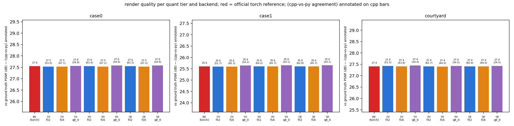
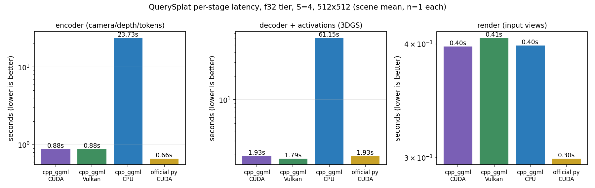
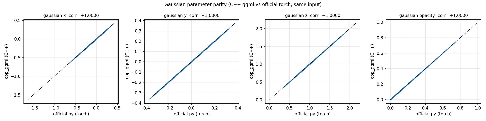
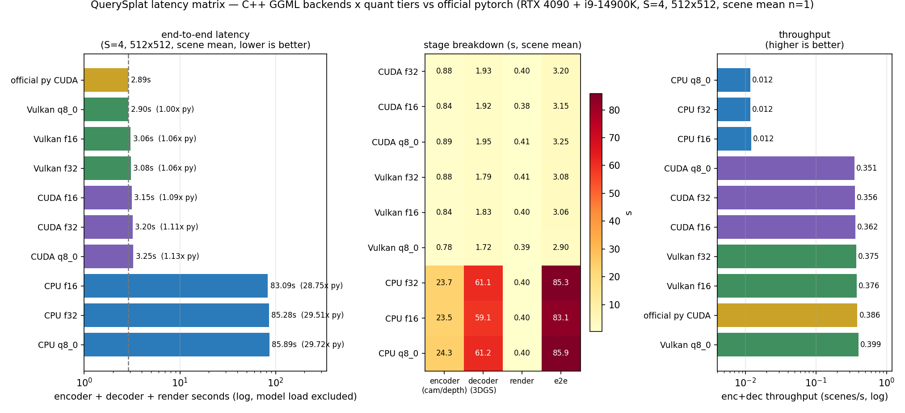
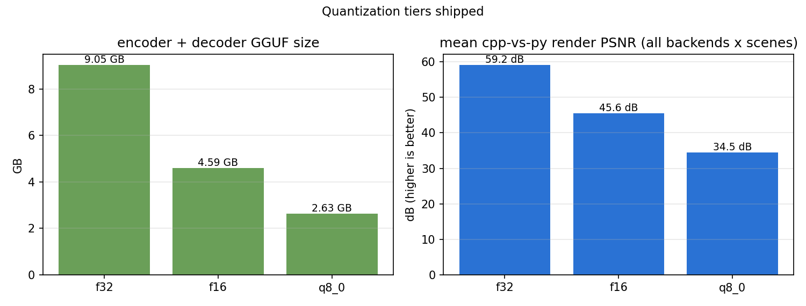
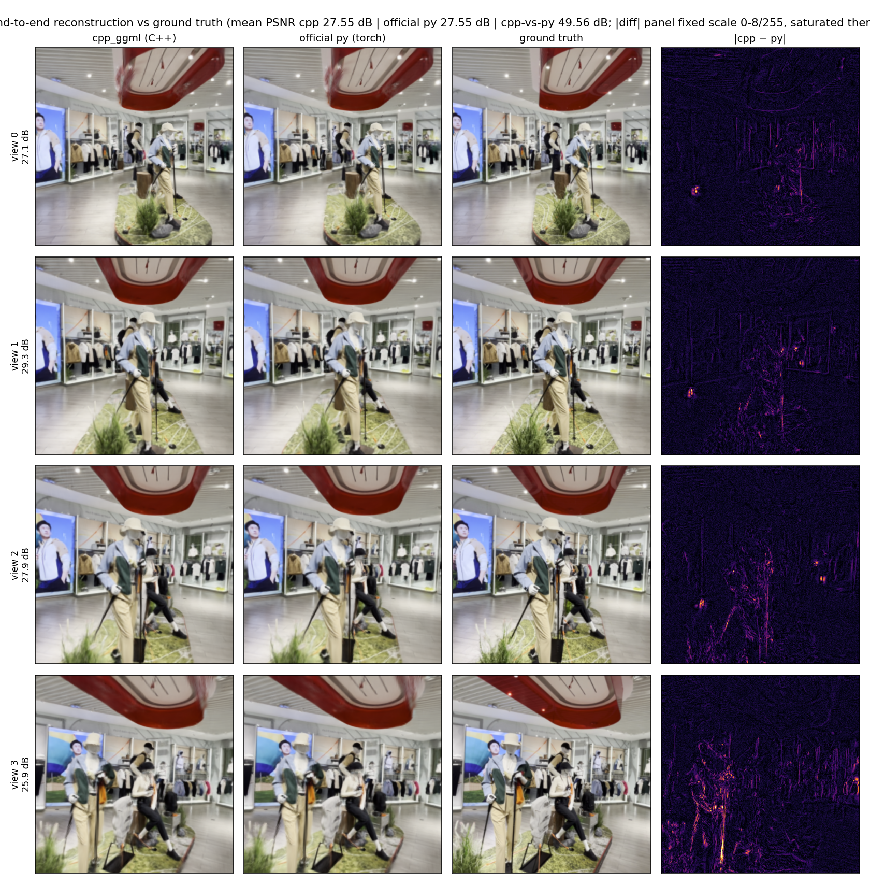
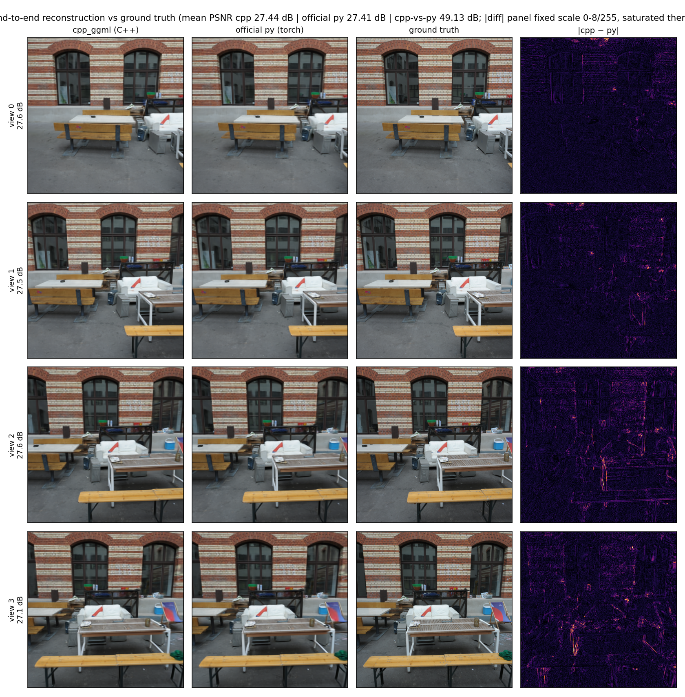

# querysplat evaluation report — C++ ggml vs official PyTorch

> Measured 2026-10-17/18 · official `inspatio/querysplat` torch f32 CUDA vs
> cpp `querysplat-paper-{f32,f16,q8_0}.gguf` + `vggt-omega-1b-512-{f32,f16,q8_0}.gguf`
> (shipped decoder family: paper) · i9-14900K (24C/32T, 94 GB) · RTX 4090 24 GB
> · every number produced by this repo's own scripts (commands in §7).
>
> History: the first measurement round (2026-10-14) ran the `8192` decoder
> family with a f16/f32/small-quant tier set and a 6-bit K-quant tier; the
> 6-bit tier lost 0.7-1.9 dB vs GT in every measured scene × backend cell
> against q8_0 (its only edge was a 0.27 GB smaller decoder) and was dropped —
> see the one-line rationale in the repo root README. The `8192` family itself
> was removed 2026-10-17 after the paper checkpoint won a 24/24-cell controlled
> comparison (§6).

## 1. Summary

| Dimension | Result |
|---|---|
| Parity gate (15 seams, paper f32, torch spy on the same GPU) | **15/15 PASS** on CPU, Vulkan (f32-accuracy mode) and CUDA — gaussians corr **+1.0000** on all three (§2) |
| Quantization | 3 Pareto tiers (S=4, means over 3 backends × 3 scenes): **f32** parity reference (cpp-vs-py 59.2 dB), **f16** compact (45.6 dB, bit-identical render to f32 — f16 weights are staged as f32), **q8_0** smallest (34.5 dB, cpp-vs-GT within 0.04 dB of f32) |
| Render agreement cpp vs official py | 48-63 dB per reference case at f32 (8-bit PNG ceiling ≈ 50 dB); means per tier in §5 |
| Speed (S=4, 512×512, enc+dec stage) | official py CUDA 2.59 s ≈ cpp CUDA f32 2.80 s ≫ cpp CPU 84.9 s; end-to-end totals in §3 |





## 2. End-to-end accuracy (parity gate, paper f32)

Every seam of the dual-graph chain (encoder tokens → fused KV → decoder
tokens → activations → gaussians) is compared against the official python
graph (spy hooks, same layouts). The thresholds are calibrated to the
measured CPU noise floor with the ≥ 1.7x headroom rule — never loosened to
make a backend pass. S=2 synthetic frames, torch spy on CUDA:

| seam (worst rows) | CPU max_rel | CUDA max_rel | Vulkan (accuracy mode) max_rel |
|---|---|---|---|
| tokens | 1.36e-4 | 1.14e-4 | 6.92e-5 |
| geom_kv_k | 1.61e-4 | 1.37e-4 | 1.41e-4 |
| deconv_raw | 1.05e-3 | 8.69e-4 | 8.74e-4 |
| gaussians | 5.80e-2 | 6.82e-2 | 4.20e-2 |
| gaussians corr | **+1.0000** | **+1.0000** | **+1.0000** |

All 15 seams PASS on all three backends (2026-10-18 logs):
`results/querysplat/gate_s2_{cpu,cuda,vulkan}.log`. CUDA and Vulkan run with
the f32-accuracy modes default-ON (§4); `--cuda-fast` / `--vk-fast` trade
accuracy for the fast kernel paths.



## 3. Speed (stage wall clock, S=4 512×512, paper family)

Means over the 3 reference scenes (case0, case1, courtyard) from the
2026-10-18 alignment matrix (fresh process per row, model load excluded):

| Row | enc+dec s | render s | total s |
|---|---|---|---|
| official py (torch f32) CUDA | 2.59 | 0.30 | — |
| cpp CUDA f32 (f32-accuracy) | 2.80 | 0.40 | 13.7 |
| cpp CUDA q8_0 (f32-accuracy) | 2.85 | 0.41 | 6.6 |
| cpp Vulkan f32 (accuracy mode) | 2.67 | 0.41 | 14.6 |
| cpp Vulkan q8_0 (accuracy mode) | 2.51 | 0.39 | 6.8 |
| cpp CPU f32 | 84.9 | 0.40 | 97.5 |
| cpp CPU q8_0 | 85.5 | 0.40 | 90.0 |

- The CUDA f16 tier measures the same enc+dec wall clock as f32 (2.76 s) —
  its weights are staged as F32 — and renders within 0.1-0.4 dB of f32.
- **One encoder pass**: the official release computes cameras/depth and then
  re-encodes inside `forward_gaussians` (`predict_cameras_and_depths` +
  `forward_decoder(forward_encoder(...))`); the C++ chain extracts cameras,
  depth and cached-layer tokens in a single pass.
- The cpp CUDA f32 row is at parity with official torch (not faster): the
  exact-F32 attention (torch SDPA-style flash vs ggml's explicit
  softmax/matmul) costs what the single-encoder-pass saves. The q8_0 tier,
  whose decoder dequantizes to F32 GEMM but skips the largest weight reads,
  ends-to-end at ~half the f32 total.
- CPU threads: ggml's default (all logical cores) is optimal on i9-14900K.
- CPU reference rasterizer (host-side for every backend): ~0.4 s/view at
  512×512 over all 524,288 gaussians (OpenMP); the CUDA rasterizer port is
  deferred (M4).



Raw JSONs: `results/querysplat/timing_{cpp,py}_s4_{cpu,vulkan,cuda}[_tier].json`.

## 4. Vulkan / CUDA accuracy modes (important)

ggml-vulkan's default fp16/coop-mat shader paths drift ~20x past the f16
CPU noise floor through the 18-block decoder (13/15 seams FAIL). Disabling
the fp16 + coop-mat + dot-product paths restores **CPU-identical floors**
and is still several-x faster than CPU. `querysplat-cli` enables this
**f32-accuracy mode by default** through the explicit
`mapggml::BackendOptions::vulkan_f32_accuracy` field (applied inside
`init_backend`; the C API exposes `mapggml_options_set_f32_accuracy` — the
former process-global `set_vulkan_f32_accuracy_mode()` env writer is
gone). Pass `--vk-fast` to trade accuracy for the default shader paths.

The same holds for CUDA: ggml-cuda converts F32 K/V to F16 inside the flash
kernels and runs cuBLAS GEMMs in TF32. `BackendOptions::cuda_f32_accuracy`
(TF32 off; formerly the `GGML_CUDA_DISABLE_TF32` env knob) +
`RuntimeOptions::f32_accuracy` (exact-F32 attention) are default-ON;
`--cuda-fast` opts out. The profiles are consumed once at the first backend
device init.

## 5. Quantization tiers (Pareto front, paper family, S=4)

| Tier | encoder + decoder files | mean cpp-vs-py | mean cpp-vs-GT | Verdict |
|---|---|---|---|---|
| f32 | 4.58 + 4.47 GB | **59.2 dB** | 26.85 | parity reference |
| f16 | 2.29 + 2.30 GB | 45.6 dB | 26.84 | compact/fast (bit-identical to f32 render — staged as f32) |
| **q8_0** | **1.32 + 1.31 GB** | 34.5 dB | **26.89** | **smallest** — cpp-vs-GT within 0.04 dB of f32 |

Read the two metrics together: cpp-vs-GT is reconstruction quality (all
tiers within 0.05 dB of the official torch chain's 26.85), cpp-vs-py is
ggml-fidelity (how close the C++ render is to the torch render of the same
weights). q8_0's 34.5 dB cpp-vs-py is the 8-bit weight rounding, not a
pipeline bug: `ggml_cast` dequantizes q8_0 weights to F32 inside the graph
(the CPU/CUDA quantized GEMMs would otherwise quantize activations too,
which measured ~1 dB of render loss). The q8_0 converter path uses gguf-py's
reference `quants.quantize` (verified byte-identical to ggml's C quantizer
on all 112 matrices). The `elm.*` layer-weight MLP stays f32 in every tier:
the C++ host fold reads raw f32/f16 only, and at ~2M params quantizing it
buys nothing.



Per-tier per-scene table: [alignment_matrix.md](alignment_matrix.md) · raw:
`results/querysplat/quant_tiers.json`.

## 6. Real-scene end-to-end reconstruction (cpp vs official py vs GT)

### 6.1 Rasterizer alignment forensic chain (2026-10-17)

**case 1 (and 237-extrap) carried a cpp RASTERIZER bug, not a model or
preprocessing issue — fixed (see cpp_ggml/README.md M2.5).** The forensic
chain, in order:

1. **Preprocessing ruled out**: the cpp `--images` bilinear resample matches
   torchvision's ImageTransform to 1 ULP (max abs 1.2e-7), and cpp fed the
   EXACT official f32 pixels via `--bin` still fogged (12.26 dB).
2. **The official chain is robust to every input variant** (measured against
   the square-crop-512 GT): original 480×270 frames 23.87 dB, its own
   ImageTransform output re-fed as 8-bit PNG 24.04 dB, PIL-resized 512
   23.91 dB. An earlier "official collapses on re-fed PNGs" row was a
   measurement artifact (GT/protocol mismatch), removed.
3. **Weights + graph ruled out**: all 521 GGUF tensors match the
   safetensors; seam dumps agree with the torch spy at f16 floors; injecting
   cpp's geom tokens into the official torch post-rgb path reproduces cpp's
   output (corr 0.996) — the decoder is faithful.
4. **The renderer convicted**: the OFFICIAL torch gaussians (which gsplat
   renders at 23.88 dB) rendered **11.93 dB** through the cpp rasterizer —
   near-plane gaussians whose centers project outside the frustum got an
   unbounded cov2d (missing gsplat/Inria `persp_proj` frustum clamp) and
   covered the screen at ~flat alpha; the 1e-4 per-gaussian alpha floor
   (gsplat: 1/255) accumulated the tails.
5. **Fixed** (cpp_ggml/src/render/rasterizer.cpp): frustum-margin clamp of
   the Jacobian z cross-terms + 1/255 alpha floor + opacity-aware bbox +
   0.999 clamp. The cpp rasterizer now reproduces gsplat per-view PSNR to
   **0.01 dB on the same gaussian bytes**.

**Full torch alignment (2026-10-17, later same day).** The residual
cpp-vs-py render gap after the rasterizer fix traced to three independent
roots, all fixed:
1. CUDA numerics: ggml-cuda F16 K/V in flash kernels + TF32 GEMMs →
   `f32_accuracy` modes, default-ON (§4);
2. encoder patch_embed f16 im2col → f32-im2col conv (submodule vggt_graph);
3. preprocessing: torchvision Resize is antialiased on downscale —
   implemented in `--images` (2.4e-7 vs torch on 4135→512); JPEG-content
   files decode through the system libjpeg (PIL's decoder; stb's IDCT
   differs ±1-2/255).

The cpp-vs-gsplat renderer residual was audited
(`analyze_render_parity.py`): top-5%-error pixels sit at tile edges at the
geometric base rate (0.446 vs 0.438) → the residual is **uniform fp
summation-order noise** through per-pixel alpha blending; single/dual-
gaussian renders are bit-exact vs gsplat.

### 6.2 Broad official-split validation (14 locally-available cases)

Both chains on every locally-available case of the official DL3DV split
jsons (10× 4-view + 4× 2-view, both on-disk scenes): **0 collapses, 0
alignment gaps** — cpp-vs-py 51-66 dB per case, cpp-vs-GT within 0.05 dB of
py-vs-GT everywhere
([broad_validation.md](https://github.com/Asher-1/querysplat-ggml/blob/main/cpp_ggml/benchmarks/results/querysplat/broad_validation.md),
runner: `benchmarks/broad_validation.py`). Figures:
[charts/querysplat/broad/](https://github.com/Asher-1/querysplat-ggml/blob/main/cpp_ggml/benchmarks/charts/querysplat/broad).





### 6.3 Decoder family swap to paper (2026-10-17)

A controlled comparison across 2 backends × 4 quant tiers × 3 scenes showed
the official paper checkpoint (`querysplat_vggto_1B_512_paper`, sh0) beating
the 8192 checkpoint in 24/24 cells by +0.71..+1.91 dB cpp-vs-GT — the
shipped decoder family is now paper: `querysplat-paper-{f32,f16,q8_0}.gguf`
(the 8192 GGUF tiers were removed; broad validation and the recon figures
were re-run with paper). Two same-day map-anything-ggml commits closed the
f16-tier CUDA gap: a759947 (stage F16 weights as F32 — f16 becomes
bit-identical to f32) and 774f3c8 (every conv through the F32-im2col
variant). Extending to the full 300-case split is a `--case-indices` away
(the remaining 53 scenes need their tars downloaded).

## 7. Reproduce

```bash
cd cpp_ggml
git submodule update --init --recursive
cmake -B build-cpu && cmake --build build-cpu -j          # CPU
cmake -B build-vulkan -DMAP_GGML_VULKAN=ON && cmake --build build-vulkan -j
cmake -B build-cuda -DMAP_GGML_CUDA=ON && cmake --build build-cuda -j

# parity gate + timing (S=2, torch spy on CUDA)
S=2 DEVICE=cpu SPY_DEVICE=cuda OUT=/tmp/qs_gate bash scripts/e2e_querysplat.sh

# alignment matrix (3 backends × 3 tiers × 3 scenes) + report figures
python3 benchmarks/alignment_matrix.py --help
python3 benchmarks/plot_benchmarks.py --work /tmp/qs_gate \
    --out benchmarks/charts/querysplat --views 2
```
